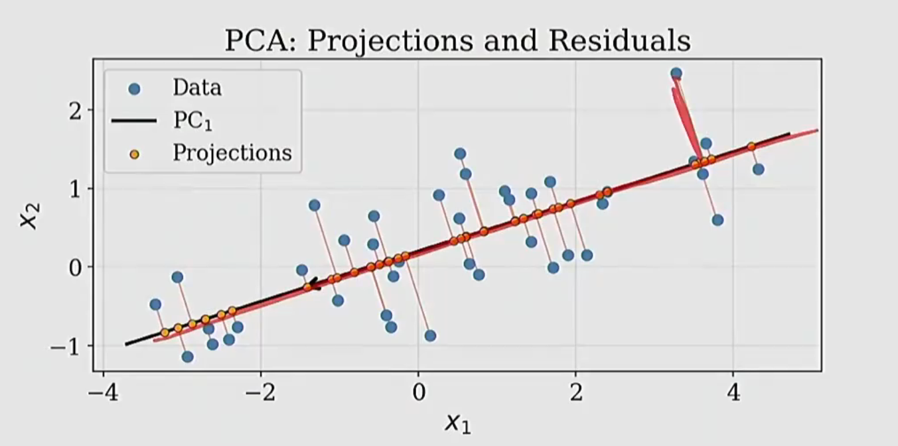

> [!Tip]
> 本文中，所有的向量都是列向量，这意味着在运算时，
>
> $$
> x^\top x = \text{constant}, \quad xx^\top = \text{matrix}
> $$
>
> 为了统一表示，减少令人困惑的交换律问题，我们的所有向量内积将以矩阵乘法的方式展现，
> 
> $$
> \langle x, x \rangle = x\cdot x \rightarrow x^\top x
> $$
>
> 这只是一种表示的转换，运算逻辑并没有改变，因此我们会在运算过程中任意地将内积换成矩阵写法，而不必给出推导。

-*-

# 引言

**最小二乘法与线性回归**即便对高中生来说都是耳熟能详的：首先给定我们一组数据 $(x, y)$，通过最小化残差平方和就可以拟合出最优的预测曲线。

这类算法实际上是一种**监督学习 (Supervised Learning)算法**。在机器学习中，我们将 $y$ 称为**标签 (label)**，$x$ 称为**特征 (Features)**， $(x,y)$ 称为**训练数据 (Training Data)**。所谓“监督”，指的就是训练数据中有标注好的标签 $y$ 。

相应地，**无监督学习**希望从没有标签的数据中挖掘出隐含的关联。例如，:tip[GMM]{info="高斯混合模型，Gaussian Mixture Model"}和K-Means希望对无标签的数据实现聚类，使用时只需确定类别的数量 $z$ ，模型便可以通过不同算法优化 $z$ 个高斯函数的参数，并返回每个点所属的类别。

本文所涉及的**PCA 算法**便是这样一种无监督学习算法，旨在通过线性组合数据:tip[特征]{info="即前文所说的 features, x"}实现高维数据的降维表示。

在机器学习中，一份训练数据可能有:tip[**成千上万个特征**]{info="比如，房价可能同时受到房屋面积、房型、房子位置、市场波动等诸多因素影响，在拟合时必须将这些特征共同考虑。"}，因此我们会将 $X$ 写成特征矩阵的形式，对于单个数据，可以简单理解为

$$
x^{(i)} = [x_1, x_2, \cdots, x_d]^\top
$$

其中每一个 $x_i$ 都代表数据的一个特征，$d$ 表示数据的维度(dimension)。上标表示这是我们数据集里的第 $i$ 个数据。

> [!note]
> 比如，对于一份单细胞转录组学数据，由于测序会返回上万个基因的表达量，此时每个细胞就对应有被测序的基因数这么多个特征。
> 
> $$
> \text{T-cells} = \bigl[\text{gene}_a,\ \text{gene}_b,\ \text{gene}_c,\ \ldots\bigr]
> $$

每一份数据需要用如此大量的特征进行表示，而人类最多只能接受和理解三维场景下的可视化，因此我们希望对数据进行降维。这种降维不仅可以让数据表示更加清晰易懂，甚至可能指出一些数据形成的底层逻辑。

> [!important]
> **流形假设(Manifold Hypothesis)**
> 
> 我们认为，虽然我们用高维向量表示我们的数据，但真实世界的数据并非均匀地充满整个高维空间，而是集中分布在一个低维的、局部近似平坦的“曲面”上。 这个低维曲面就叫**流形(manifold)**。
>
> 因此，我们相信对数据的降维是一种合理且有实际意义的操作。

PCA 算法，全称为Principal Component Analysis，主成分分析，就是一种基于矩阵分解的降维方法，接下来，我们将展示其推导过程。

-*-

# PCA 算法的数学原理

PCA 算法的逻辑是，为了实现数据降维，我们先要在空间中旋转坐标系，使坐标轴对应到数据差异最大的方向上。随后，我们保留数据差异最大的前 $k$ 个维度，就得到了高维数据的低维表示。

我们首先明确以下几点：

1. 数据和新的 $k$ 个单位基向量 $u$ 都需要用 $d$ 维向量进行表示，这组向量的基就是初始数据所用的那组基，即

   $$
   x, u \in \mathbb{R}^{d}
   $$

2. 我们的最终目的是选取一组向量，

   $$
   u_1, u_2, \cdots, u_k\qquad(k<d)
   $$

   从而实现降维。

   这组单位向量两两正交，这意味着它们满足

   $$
      u_i^\top u_j=
         \begin{cases}
         1&i=j\\
         0&i\ne j
         \end{cases}
   $$

3. 用于 PCA 的数据已经进行了中心化，即均值为 $0$，在特殊情况下，还需要做 Z 标准化处理，在中心化的基础上额外除以标准差。

4. 降维的设计分为两步：

   - 首先，为了找到数据分布的新的子空间，我需要构造一种寻找基向量的方法；
   - 应用这组基向量后，我需要找到一种实现从全空间到子空间**投影(Projecting)**的方法。

   
   
   现在我就将全空间上的点以**特定**的方法投影到**特定**的子空间上。而衡量我们这种**特定**构造的降维算法是否好的一种思路是：

   如果我将降维后的数据点恢复到原先的高维空间中，其与原数据点是否足够接近。只有这样，才能尽可能多地保留高维数据的全部信息。我们称这个表示的差距为:tip[**重构误差(或者说是残差，Residual)**]{info="或许你可以理解为这就是 PCA 的损失函数(loss function)"}。

-*-

## 通过垂直投影最小化重构误差

倒着思考，假设现在通过某种算法，我们找到了 $k$ 个基向量，问题在于，如何投影数据才足够好呢？现在我们引入前文的重构误差。

取这个 $k$ 维子空间的一个点 $A$，

$$
a = (\alpha_1, \alpha_2, \cdots, \alpha_k)^\top
$$

现在，我们找 $A$ 在原本的 $d$ 维空间中的向量表示。由于我们的每一个基向量 $u_i$ 都是 $d$ 维的，而上式告诉我们：

$$
a^* = \sum_{i=1}^{k} \alpha_i u_i
$$

于是我们自然地得到了 $A$ 在高维空间中的表示 $A^*$ 。

为了让 $A$ 成为样本点 $X$ 的最佳投影，我们用欧氏距离 $\left\lVert X - A^* \right\rVert^{2}$ 来表示重构误差，并调整 $A$ 的坐标来最小化它，即

$$
\begin{align*}
a = (\alpha_1, \alpha_2, \cdots, \alpha_k)^\top  
  &= \argmin_{\alpha_1,\dots,\alpha_k \in \mathbb{R}}
     \left\lVert x - \sum_{i=1}^{k} \alpha_i u_i \right\rVert^{2} \\[1.4ex]
  &= \argmin_{\alpha_1,\dots,\alpha_k \in \mathbb{R}}
     \left\lVert x \right\rVert^{2}
     + \sum_{i=1}^{k} \left(\alpha_i^{2}
     - 2\alpha_i(x^\top u_i)\right)
\end{align*}
$$

在第二步中，我们用到了基向量的正交性，即 $u_i\cdot u_j = 0$。由上式，对于每一个 $\alpha_i$，函数都只是一个二次多项式，于是就得到了重构误差最小时，$X$的投影，或者说 $A$ 的坐标，

$$
\alpha_i = x^\top u_i = u_i^\top x
$$

这实际上就是把 $X$ 垂直投影到子空间的每一个基向量上，上述内容的目的是证明垂直投影在欧氏距离的意义上最佳。

-*-

## 通过矩阵分解寻找最优基向量

### 最大化投影方差

前一节我们解决了降维的第二步。垂直投影对于任何一种基向量选取而言都是最小化重构误差的方法。接着我们就要解决第一步的问题，即如何构造新的基向量。这正是 PCA 算法的核心。

显然，我们还要回到**最小化重构误差**这一概念。实际上我们前面设计的重构误差 $\left\lVert X - A^* \right\rVert^{2}$ 同时是 $u$ 和 $\alpha$ 的函数，也因此，前文所述的“两步”在某种意义上就是对 PCA 的损失函数求偏导，再找极小值。

为了简化讨论和表示，这里我们会先考虑一维 PCA，也就是说，我们只关心一个主成分。假设我们有 $n$ 个样本，在前面重构误差的基础上还需要加上多样本平均，这里用 $x^{(i)}$ 表示第 $i$ 个样本。

$$
\frac{1}{n} \sum_{i=1}^{n} \left\lVert x^{(i)} - A^* \right\rVert^{2}
$$

下面我们用 $u$ 表示第一主成分

$$
\begin{align*}
u &= \argmin_{u \in \mathbb{R}^{d},\, \lVert u\rVert = 1}
     \frac{1}{n}\sum_{i=1}^{n} \left\lVert x^{(i)} - \alpha_i u \right\rVert^{2} \\[1.4ex]
  &= \argmin_{u \in \mathbb{R}^{d},\, \lVert u\rVert = 1}
     \frac{1}{n}\sum_{i=1}^{n} \left( \left\lVert x^{(i)} \right\rVert^{2}
     - 2\alpha_i\left( x^{(i)\top}u \right) + \alpha_i^{2} \right) \\[1.4ex]
  &= \argmin_{u \in \mathbb{R}^{d},\, \lVert u\rVert = 1}
     \frac{1}{n}\sum_{i=1}^{n} \left\lVert x^{(i)} \right\rVert^{2}
     + \frac{1}{n}\sum_{i=1}^{n} \left( \alpha_i^{2}
     - 2\alpha_i\left( x^{(i)\top}u \right) \right)
\end{align*}
$$

现在，最佳的 $\alpha$ 实际上是 $u$ 和 $x^{(i)}$ 的函数，我们把它代回重构误差的式子，由于 $\alpha_i = x^({i})^\top u = u^\top x^({i})$，因此代入后可以得到

$$
\begin{align*}
u &= \argmin_{u \in \mathbb{R}^{d},\, \lVert u\rVert = 1} \frac{1}{n}\sum_{i=1}^{n}\left\lVert x^{(i)} \right\rVert^{2} - \frac{1}{n}\sum_{i=1}^{n} \left( u^{\top} x^{(i)} \right)^{2} \\[1.4ex]
  &= \argmax_{u \in \mathbb{R}^{d},\, \lVert u\rVert = 1} \frac{1}{n}\sum_{i=1}^{n} \left( u^{\top} x^{(i)} \right)^{2}
\end{align*}
$$

> [!tip]
> 这里下标的意义发生改变了，$\alpha$ 的下标不再代表第 $i$ 个主成分，而是第 $i$ 个样本向主成分 $u$ 投影的系数

这里我们发现，最小化重构误差的过程，就是最大化投影方差的过程，这也就是为什么 PCA 实际上有两种表示方法，即原式的**最小化重构误差**和化简后的**最大化投影方差**。

“投影方差”这个定义十分深刻。现在我们从另一个视角看看这个结果：我们在做的事情是将样本沿方向 $u$ 进行投影，得到的实际上是新的变量，样本被从 $d$ 维映射为一维变量，记作

$$
z^{(i)} = u^\top x^{(i)}
$$

而 $z$ 是一个均值为 $0$ 的随机变量，那么 $z$的方差是多少呢？

$$
\text{Var}(z) = \frac{1}{n} \sum_{i=1}^{n} \left(z^{(i)}\right)^{2} = \frac{1}{n}\sum_{i=1}^{n} \left( u^{\top} x^{(i)} \right)^{2}
$$

可见，寻找一个:tip[主成分]{info = "我们到目前为止，都还没有引入如何衡量“第一/最大主成分”，因此这里和下面的许多结论都适用于所有主成分"}竟然恰好就是在最大化所有样本被投影后的随机变量的方差！这也就是为什么，我们称这个行为是最大化投影方差。而且，这一点非常符合我们的直觉，可以尝试旋转坐标轴，让所有点垂直投影到新的坐标轴上。如果我们想寻找主成分，确实就需要放大这些投影的长度！

<figure style="margin:1.5rem 0;padding:1rem;border:1px solid rgba(128,128,128,.25);border-radius:12px;">
<svg viewBox="0 0 500 215" width="100%" role="img" aria-label="两个投影方向的比较" xmlns="http://www.w3.org/2000/svg"><g transform="translate(125 100)"><path d="M-100 0H100 M0 -70V70" stroke="currentColor" opacity=".15" fill="none"/><line x1="-90.63" y1="-42.26" x2="90.63" y2="42.26" stroke="#0d9488" stroke-width="2"/><line x1="-72" y1="36.0" x2="-45.35" y2="-21.15" stroke="#d97706" stroke-dasharray="3 3" opacity=".8"/><circle cx="-45.35" cy="-21.15" r="3" fill="#0d9488"/><circle cx="-72" cy="36.0" r="4" fill="#64748b"/><line x1="-48" y1="38.400000000000006" x2="-24.72" y2="-11.53" stroke="#d97706" stroke-dasharray="3 3" opacity=".8"/><circle cx="-24.72" cy="-11.53" r="3" fill="#0d9488"/><circle cx="-48" cy="38.400000000000006" r="4" fill="#64748b"/><line x1="-24" y1="4.800000000000001" x2="-17.87" y2="-8.34" stroke="#d97706" stroke-dasharray="3 3" opacity=".8"/><circle cx="-17.87" cy="-8.34" r="3" fill="#0d9488"/><circle cx="-24" cy="4.800000000000001" r="4" fill="#64748b"/><line x1="-12.0" y1="16.799999999999997" x2="-3.42" y2="-1.60" stroke="#d97706" stroke-dasharray="3 3" opacity=".8"/><circle cx="-3.42" cy="-1.60" r="3" fill="#0d9488"/><circle cx="-12.0" cy="16.799999999999997" r="4" fill="#64748b"/><line x1="12.0" y1="-16.799999999999997" x2="3.42" y2="1.60" stroke="#d97706" stroke-dasharray="3 3" opacity=".8"/><circle cx="3.42" cy="1.60" r="3" fill="#0d9488"/><circle cx="12.0" cy="-16.799999999999997" r="4" fill="#64748b"/><line x1="24" y1="-4.800000000000001" x2="17.87" y2="8.34" stroke="#d97706" stroke-dasharray="3 3" opacity=".8"/><circle cx="17.87" cy="8.34" r="3" fill="#0d9488"/><circle cx="24" cy="-4.800000000000001" r="4" fill="#64748b"/><line x1="48" y1="-38.400000000000006" x2="24.72" y2="11.53" stroke="#d97706" stroke-dasharray="3 3" opacity=".8"/><circle cx="24.72" cy="11.53" r="3" fill="#0d9488"/><circle cx="48" cy="-38.400000000000006" r="4" fill="#64748b"/><line x1="72" y1="-36.0" x2="45.35" y2="21.15" stroke="#d97706" stroke-dasharray="3 3" opacity=".8"/><circle cx="45.35" cy="21.15" r="3" fill="#0d9488"/><circle cx="72" cy="-36.0" r="4" fill="#64748b"/></g><g transform="translate(375 100)"><path d="M-100 0H100 M0 -70V70" stroke="currentColor" opacity=".15" fill="none"/><line x1="-86.60" y1="50.00" x2="86.60" y2="-50.00" stroke="#0d9488" stroke-width="2"/><line x1="-72" y1="36.0" x2="-69.59" y2="40.18" stroke="#d97706" stroke-dasharray="3 3" opacity=".8"/><circle cx="-69.59" cy="40.18" r="3" fill="#0d9488"/><circle cx="-72" cy="36.0" r="4" fill="#64748b"/><line x1="-48" y1="38.400000000000006" x2="-52.63" y2="30.38" stroke="#d97706" stroke-dasharray="3 3" opacity=".8"/><circle cx="-52.63" cy="30.38" r="3" fill="#0d9488"/><circle cx="-48" cy="38.400000000000006" r="4" fill="#64748b"/><line x1="-24" y1="4.800000000000001" x2="-20.08" y2="11.59" stroke="#d97706" stroke-dasharray="3 3" opacity=".8"/><circle cx="-20.08" cy="11.59" r="3" fill="#0d9488"/><circle cx="-24" cy="4.800000000000001" r="4" fill="#64748b"/><line x1="-12.0" y1="16.799999999999997" x2="-16.27" y2="9.40" stroke="#d97706" stroke-dasharray="3 3" opacity=".8"/><circle cx="-16.27" cy="9.40" r="3" fill="#0d9488"/><circle cx="-12.0" cy="16.799999999999997" r="4" fill="#64748b"/><line x1="12.0" y1="-16.799999999999997" x2="16.27" y2="-9.40" stroke="#d97706" stroke-dasharray="3 3" opacity=".8"/><circle cx="16.27" cy="-9.40" r="3" fill="#0d9488"/><circle cx="12.0" cy="-16.799999999999997" r="4" fill="#64748b"/><line x1="24" y1="-4.800000000000001" x2="20.08" y2="-11.59" stroke="#d97706" stroke-dasharray="3 3" opacity=".8"/><circle cx="20.08" cy="-11.59" r="3" fill="#0d9488"/><circle cx="24" cy="-4.800000000000001" r="4" fill="#64748b"/><line x1="48" y1="-38.400000000000006" x2="52.63" y2="-30.38" stroke="#d97706" stroke-dasharray="3 3" opacity=".8"/><circle cx="52.63" cy="-30.38" r="3" fill="#0d9488"/><circle cx="48" cy="-38.400000000000006" r="4" fill="#64748b"/><line x1="72" y1="-36.0" x2="69.59" y2="-40.18" stroke="#d97706" stroke-dasharray="3 3" opacity=".8"/><circle cx="69.59" cy="-40.18" r="3" fill="#0d9488"/><circle cx="72" cy="-36.0" r="4" fill="#64748b"/></g><g fill="currentColor" font-size="13" text-anchor="middle"><text x="125" y="190">较小投影方差</text><text x="375" y="190">较大投影方差</text></g></svg>
</figure>

总之，回到正题。现在，我们优化的目标是这个式子：

$$
\begin{align*}
&= \argmax_{u \in \mathbb{R}^{d}, \lVert u\rVert = 1}\frac{1}{n}\sum_{i=1}^{n} {(u^\top x^{(i)})}^{2}\\[1.4ex]
&= \argmax_{u \in \mathbb{R}^{d}, \lVert u\rVert = 1} u^\top\underbrace{\left( \frac{1}{n}\sum_{i=1}^{n} x^{(i)}(x^{(i)})^\top \right)}_{M} u
\end{align*}
$$

这里的 $M$ 是协方差矩阵。接下来我们说明为什么这一项是协方差矩阵。

---

#### 协方差矩阵

协方差定义为

$$
\text{Cov}(X,Y) = \mathbb{E}\left[\,\bigl(X-\mathbb{E}[X]\bigr)\bigl(Y-\mathbb{E}[Y]\bigr)\right]
$$

现在，假设我们有一组特征 $X_i$，协方差矩阵的 $(i,j)$ 处记录的就是 $X_i$ 和 $X_j$ 的协方差。注意，协方差矩阵是**实对称矩阵**，因为协方差满足对称性。又考虑到我们对特征进行了中心化，即 $\mathbb{E}[X] = 0$，因此

$$
\sigma_{ij} = \text{Cov}(X_i, X_j) = \mathbb{E}(X_iX_j)
\qquad i,j = 1,\dots,d
$$

考虑到我们有 $n$ 个样本，因此随机变量 $X_iX_j$ 的均值只需对多个样本的结果求平均，即

$$
\sigma_{ij} = \text{Cov}(X_i, X_j) = \frac{1}{n}\sum_{k=1}^{n} x_i^{(k)} x_j^{(k)},
\qquad i,j = 1,\dots,d
$$

由于我们的每个样本是这样表示的

$$
x^{(k)}=
\begin{pmatrix}
x_1^{(k)}\\
x_2^{(k)}\\
\vdots\\
x_d^{(k)}
\end{pmatrix}
$$

容易证明，对于上一节的矩阵 M

$$
\begin{align*}
m_{ij}
&=\left[\frac1n\sum_{k=1}^n x^{(k)}(x^{(k)})^T\right]_{ij}\\
&=\frac1n\sum_{k=1}^n
[x^{(k)}(x^{(k)})^T]_{ij}\\
&=\frac1n\sum_{k=1}^n x_i^{(k)}x_j^{(k)}\\
&=\sigma_{ij}
\end{align*}
$$

可见 $M$ 就是协方差矩阵 $\Sigma$，下面统一使用该记号。

-*-

### 将二次型优化转化成特征值优化

$$
\argmax_{u \in \mathbb{R}^{d}, \lVert u\rVert = 1} u^\top \Sigma u
$$

由于协方差矩阵与 $u$ 无关，现在我们只需要优化这个二次型了。

现在我们要考虑一种通用的情况，考虑一个一般的二次型优化问题

$$
\argmax_{x \in \mathbb{R}^{d}, \lVert x \rVert = 1} x^\top Ax
$$

其中，$A$ 是一个实对称矩阵，其特征值为 $\lambda_i$。实对称矩阵可正交对角化，即$A=U\Lambda U^\top$，其中 $U$ 是正交矩阵，其列向量构成 $A$ 的一组特征向量。同时，对角矩阵$\Lambda = \text{diag}\{\lambda_1, \lambda_2,\cdots, \lambda_d\}$。

现在我们在 $A$ 的特征向量张成的空间中表示 $x$，

$$
x=\sum_{j=1}^d \alpha_j u_j
$$

对于矩阵的特征值 $\lambda$ 及其特征子空间中的向量 $u$ ，有

$$
Au = \lambda u
$$

回到原式，

$$
x^\top Ax = x^\top U \Lambda\sum_{j=1}^d \alpha_j U^\top u_j
$$

考虑 $U$ 是一个正交矩阵，在后面的求和项中，$U^\top u_j = e_j$，这里 $e_j$ 是第 $j$ 个分量为 $1$ 的标准基向量。

这一单位向量的出现允许我们把前面复杂的矩阵全都变成单个向量纳入求和项，

$$
\begin{align*}
x^\top Ax 
  &= x^\top U \Lambda\sum_{j=1}^d \alpha_j e_j\\
  &= x^\top U \sum_{j=1}^d \lambda_j \alpha_j e_j\\
  &= x^\top \sum_{j=1}^d \lambda_j \alpha_j u_j\\
  &= \sum_{i=1}^d \alpha_i u_i^\top \cdot \sum_{j=1}^d \lambda_j \alpha_j u_j
\end{align*}
$$

然后我们又用到正交性质，在两个求和项交叉相乘时，当且仅当 $i=j$ 时子项不为 $0$。于是我们得到了一个很漂亮的结论

$$
x^\top Ax = \sum_{j=1}^d\alpha_j^2 \lambda_j 
$$

> [!note]
> 这段完全抄的 CS229，实际上有更简洁的写法：
> 首先我们有
> 
> $$
> x=\sum_{j=1}^d \alpha_j u_j = U\alpha, \quad \alpha = U^\top x
> $$
>
> $$
> \begin{align*}
> x^\top Ax 
>   &= x^\top U \Lambda U^\top x \\[1.4ex]
>   &= \left(U^\top x\right)^\top \Lambda U^\top x \\[1.4ex]
>   &= \alpha^\top U \alpha \\
>   &= \sum_{j=1}^d \lambda_j \alpha_j u_j
> \end{align*}
> $$

现在，我们想要求二次型的最大值，只需要先确定实对称矩阵的特征值，再构造 $x$ 的坐标即可，也就是说

$$
\max_{x:\,\lVert x\rVert^{2}=1} x^{\top}Ax
\quad\text{is equivalent to}\quad
\max_{\alpha:\,\lVert\alpha\rVert^{2}=1}\sum_{j=1}^{d}\alpha_j^{2}\lambda_j
$$

> [!tip]
> 从这里开始，我们才引入主成分的次序

如何求最大值呢，显然我们只需要找到最大的主成分，这里不妨就称为 $\lambda_1$，由于

$$
\sum \alpha_i^2 = 1
$$

因此当且仅当我们令 $\alpha_1 = 1$ 时，右边的项最大，此时 $x=u_1$，这里 $u$ 是最大的特征值对应的特征向量。

接着我们要递推确认剩下的主成分。以第二主成分为例，由于主成分之间是正交的，这意味着我们必须令 $\alpha_1 = 0$，重复上面的验证可知，这里只需令第二大特征值前面的系数为 $1$ 就可以了。进一步地，就一一对应了所有主成分。

> [!tip]
> 这里我们本质上是对特征值进行加权，把权重全给最大值肯定是最优解。严格的证明可以用拉格朗日乘子法，下面我们还会基于此给出一种新的推导方案。

回到原式，

$$
\argmax_{u \in \mathbb{R}^{d}, \lVert u\rVert = 1} u^\top \Sigma u \Rightarrow \argmax_{\alpha:\,\lVert\alpha\rVert^{2}=1} \sum_{j=1}^{d}\alpha_j^{2}\lambda_j
$$

按照上面的说法，第一主成分对应的 $u$ 就是**协方差矩阵最大的特征值对应的特征向量**。不仅如此，这个式子还告诉我们，样本沿任意主成分方向的投影方差，就等于其协方差矩阵各个特征值按照该方向在特征向量上的分量平方进行加权的结果，所以要获得最大的投影方差，最好的选择就是完全沿着最大特征值对应的方向投影。

因此我们得到了第一个结论：**投影方差在取特征向量方向时取极值**。

> [!tip]
> 这里再次明确下标的定义，我们是在将主成分 $u$ 用协方差矩阵的一组特征向量来表示，每一个分量的系数即 $\alpha_j$。

同时，容易证明，:tip[**数据沿特征向量 $v_i$ 的投影方差恰好等于对应的特征值 $\lambda_i$**]{info="提示，尝试把前文的 $u$ 改成 $v$"}。

现在我们发现，研究一组特征的主成分竟然只需要关心它的协方差矩阵。这是因为协方差矩阵刻画了数据在不同特征方向上的变异程度，以及特征之间的线性相关结构，也因此能帮助我们最大化投影方差。协方差矩阵的:tip[**谱分解**]{info = "也称特征值分解，EVD，Eigen Value Decomposition，也就是所谓矩阵对角化"}告诉我们，假设其特征向量为 $v_i$，则

$$
\Sigma=V\Lambda V^T = \sum_{i=1}^d \lambda_i v_i v_i^\top
$$

其中，$v_i$ 为单位特征向量，$\lambda_i$ 为对应的特征值，且按照从大到小排列：

$$
\lambda_1\geq\lambda_2\geq\cdots\geq\lambda_d\geq0
$$

可以说明，在降维时，越小的特征值对协方差矩阵的贡献越不明显，因此我们可以在某处截断并保留前 $k$ 项。PCA 的核心思想，就是保留这些主要方向，舍弃方差较小的方向，从而在尽可能保留数据变化的同时降低维度。我们可以从两个角度说明这种截断的合理性，请见[方差贡献率与 Frobenius 范数](#方差贡献率与-frobenius-范数)。

-*-

### 在拉格朗日乘子法视角下重新推导

上面我们通过将二次型转化成特征值，推导出主成分即特征向量。这里我们给出一种基于拉格朗日乘子法的推导方法。

我们现在的问题本质上是一个带约束的最值问题：

$$
\max_{u}\  u^\top \Sigma u
\quad\text{s.t.}\quad  u^\top u=1
$$

用拉格朗日乘子法，令
$$
\mathcal L(u,\lambda)= u^\top\Sigma u -\lambda(u^\top u-1)
$$

对 $u$ 求:tip[偏导]{info="这里略去矩阵求导的过程，作为补充，只需要知道矩阵求导本质上是对矩阵里的每一个标量做求导操作，最后得到了一套规律，实际上并没有更复杂的约定。"}并令其为零，得

$$
\Sigma u=\lambda u
$$

该方程的所有解正好就是协方差矩阵的所有特征值及对应的特征向量！这些解就是方差的极值点，带回原式，我们立刻得到

$$
u^\top\Sigma u=\lambda
$$

上面两个结论也就是我们前面所说过的：

1. 投影方差在取特征向量方向时取极值；
2. 投影方差的极值恰好就是该特征向量对应的特征值。

拉格朗日乘子法直接告诉了我们这两个结论，而省去了从二次型到平方加权的过渡。 

进一步地，想要拓展到更多的方向，只需补充约束，:tip[即可递推证明所有主成分都对应一个特征向量。]{info="这里的证明有一个特征值这块常用的trick，要用到前面的结论 $u^\top\Sigma u=\lambda$ 读者可自行尝试证明。"}

$$
\max_{u_2,}\  u_2^\top \Sigma u_2
\quad\text{s.t.}\quad  u_2^\top u_2=1, u_2^\top u = 0
$$

-*-

# PCA 算法的应用

通过上述内容，我们证明了这样一件事情：

> [!important]
> 对协方差矩阵进行特征值分解，然后保留前 $k$ 大的特征值，取其特征向量$ u \in \mathbb R^d$，就得到了我们所关心的 $k$ 个主成分。

接下来对 PCA 的实际应用做说明。

## 数据中心化与标准化

在证明过程中，我们多次利用了“数据均值为零”这一条件。如果数据均值不为零，协方差矩阵不会自动出现在推导过程中。非中心化的数据会导致第一主成分表示“数据质心相对原点的偏移方向”，这与数据内部结构无关。不过，**非中心化 PCA(uncentered PCA)**会带给我们一些意外收获，在后面我们会讲述。

除此之外，对于单位不同的数据（比如，用厘米表示的身高，用吨表示的体重），最大化投影方差可能会受到单位数量级的影响，这时我们应当进行 Z 标准化，额外除以数据标准差。

> [!tip]
> 值得注意的是，不是所有数据都要进行标准化。比如，对于基因表达谱而言，不同基因表达量不同可能反映了真实的生物学逻辑，而不是量纲有问题。

实际上，另一条 PCA 的路径是先计算**相关系数矩阵**，我们可以证明求相关系数矩阵就是在对原本的数据同时完成中心化和标准化并得到协方差矩阵，相当于把这个过程一次性打包了。

$$
\begin{align*}
\rho_{ij}
&= \frac{\text{Cov}(x_i,x_j)}{\sqrt{\text{Var}(x_i)}\,\sqrt{\text{Var}(x_j)}} \\[1ex]
&= \frac{\text{Cov}(x_i,x_j)}{\sigma_{x_i}\,\sigma_{x_j}} \\[1ex]
&= \mathbb{E}\!\left[\frac{\bigl(x_i-\mathbb{E}[x_i]\bigr)\bigl(x_j-\mathbb{E}[x_j]\bigr)}{\sigma_{x_i}\,\sigma_{x_j}}\right] \\[1ex]
&= \mathbb{E}\!\left[\frac{x_i-\mathbb{E}(x_i)}{\sigma_{x_i}}\cdot\frac{x_j-\mathbb{E}(x_j)}{\sigma_{x_j}}\right] \\[1ex]
&= \sigma_{ij}
\end{align*}
$$

随后求解特征值和特征向量即可。

-*-

## 方差贡献率与 Frobenius 范数

### 欧氏距离下的方差贡献率

在很前面的地方，我们用欧氏距离定义了重构误差，对于 $k$ 个主成分，考虑样本平均意义下的重构误差

$$
\frac{1}{n} \sum_{j=1}^{n} \lVert X^{(j)}-A \rVert ^2 = \frac{1}{n} \sum_{j=1}^{n}\lVert x^{(j)} \rVert ^2 -\frac{1}{n}\sum_{i=1}^{k}\sum_{j=1}^{n} {(u_i^\top x^{(i)})}^{2}
$$

并且我们证明了后者的极值对应了前 $k$ 大的特征值，则重构误差可以表示为：

$$
\frac{1}{n} \sum_{j=1}^{n}\lVert x^{(j)} \rVert ^2 - \sum_{i=1}^{k} \lambda_i
$$

当我们保留所有主成分时，$d$ 个特征向量就构成了空间的一组标准正交基，这保证了 $x$ 可以用这 $d$ 个主成分完整地表示出来，于是

$$
\begin{align*}
\frac{1}{n}\sum_{j=1}^{n}\|x^{(j)}\|^2
&=\frac{1}{n}\sum_{j=1}^{n}
\sum_{i=1}^{d}(u_i^\top x^{(j)})^2\\[8pt]
&=\sum_{i=1}^{d}
\underbrace{
\frac{1}{n}\sum_{j=1}^{n}
(u_i^\top x^{(j)})^2
}_{\lambda_i}\\[8pt]
&=\sum_{i=1}^{d}\lambda_i
\end{align*}
$$

重构误差就等于

$$
\sum_{i=k+1}^d \lambda_i
$$

实际上，由于数据都是中心化的，计算重构误差时，我们就是在将数据的方差投影到 $d$ 个主成分上。因此我们把第 $k$ 个主成分的方差贡献率定义为

$$
r_k=\frac{\lambda_k}{\sum_{i=1}^{d}\lambda_i}
$$

> [!note]
> 一般我们称，第 $k$ 个主成分解释了数据总方差中 $r_k$ 的比例。

前 $k$ 个的累计贡献率为 $R_k=\sum_{i=1}^{k}r_i$。

可见，特征值线性地影响欧氏距离定义的重构误差，这意味着保留较大的特征值是有意义的。

---

### Frobenius 范数与 EVD 意义下的重构误差

前面我们提到

$$
\Sigma=V\Lambda V^T = 
\lambda_1\underbrace{v_1v_1^\top}_{M_1}
+\lambda_2\underbrace{v_2v_2^\top}_{M_2}
+\cdots+
\lambda_d\underbrace{v_dv_d^\top}_{M_d}
$$

这里的每一个 $M_i$ 都是一个秩为 $1$ 的矩阵，原始协方差矩阵被拆解成 $d$ 个秩一矩阵的加权和，权重为特征值。

现在我们介绍 Frobenius 范数。其概念非常简单，就是对矩阵内每一个值求平方和再开根号，数学表达为：

$$
\|A\|_F^2=\sum_{i,j}A_{ij}^2=\operatorname{tr}(A^\top A)
$$

> [!tip]
> 尝试用 Frobenius 范数类比一维情况下的“向量模长”，本质上是该概念的拓展。你可以把下面的推导看成是在相同大小的矩阵空间（$d\times d$）中的勾股定理，勾股定理中的向量长度在这里变成了 Frobenius 范数。

对于任意一个 $M_i=v_iv_i^\top$：

$$
\begin{align*}
\|M_i\|_F^2
&=\operatorname{tr}(M_i^\top M_i)\\[6pt]
&=\operatorname{tr}(v_iv_i^\top v_iv_i^\top)\\[6pt]
&=\operatorname{tr}(v_iv_i^\top)\\[6pt]
&=v_i^\top v_i\\[6pt]
&=1
\end{align*}
$$

也就是说

$$
\lVert \lambda_i M_i \rVert _F = \lambda_i
$$

于是，每一个特征值直接对应了 EVD 中其对应的秩一矩阵的 Frobenius 范数大小。

接着，我们定义矩阵的 Frobenius 内积：

$$
\langle A,B\rangle_F
=\operatorname{tr}(A^\top B)
$$

立刻得到，

$$
\begin{aligned}
\langle M_i,M_j\rangle_F
&=\operatorname{tr}(M_i^\top M_j)\\[6pt]
&=\operatorname{tr}(v_iv_i^\top v_jv_j^\top)\\[6pt]
&=(v_i^\top v_j)(v_j^\top v_i)\\[6pt]
&=(v_i^\top v_j)^2\\[6pt]
&=\delta_{ij}
\end{aligned}
$$

这告诉我们，这些秩一矩阵在空间中相互正交。

综上，我们可以把协方差矩阵的 EVD 理解为其在矩阵空间中的正交分解。我们可以从一个新的视角看待重构误差，即衡量选取 $k$ 个特征值后，我们在多大程度上恢复了原有的协方差矩阵。

近似构造的协方差矩阵为

$$
\hat{\Sigma}_k=\sum_{i=1}^{k}\lambda_i v_iv_i^\top
$$

此时的误差矩阵为

$$
\Sigma-\hat{\Sigma}_k = \sum_{i=k+1}^{d}\lambda_i v_iv_i^\top
$$

利用前面秩一矩阵的正交性质

$$
\begin{aligned}
\|\Sigma-\hat{\Sigma}_k\|_F^2
&=\left\|
\sum_{i=k+1}^{d}\lambda_i M_i
\right\|_F^2\\[6pt]
&=\sum_{i=k+1}^{d}\lambda_i^2\|M_i\|_F^2\\[6pt]
&=\sum_{i=k+1}^{d}\lambda_i^2
\end{aligned}
$$

于是我们得到了下面的式子

$$
\|\Sigma-\hat{\Sigma}_k\|_F^2 = \sum_{i=k+1}^{d}\lambda_i^2
$$

当然，协方差矩阵和重构的协方差矩阵的 Frobenius 范数则各自对应了全空间和子空间上的特征值平方和。从这个视角来看，抛弃更大的特征值会导致更大的协方差矩阵重构误差，因此我们的截断从这个角度看同样是有意义的。

-*-

## SVD 与 Uncentered PCA

### SVD

主播主播，先储存一个协方差矩阵然后做EVD确实很强，但是还是太吃内存了，有没有更加简单、更快捷的算法？

> [!note]
> 假设我们一个样本有 $20,000$ 个 features，就需要储存一个 $400,000,000$ 个元素的对称矩阵。

因此，我们要用到一个重要的分解方法 **奇异值分解(SVD, Singular Value Decomposition)**。

对于任意一个矩阵，我们都可以将其表示为：

$$
A = U\Sigma V^\top
$$

其中：
1. $U$ 是 $m$ 阶正交矩阵，列向量为 $A$ 的左奇异向量，对应 $AA^\top$ 的特征向量;
2. $\Sigma$ 是 $m\times n$ 的对角矩阵，对角线上的元素为奇异值 $\sigma$；
3. $V^\top$ 是 $n$ 阶正交矩阵，行向量为 $A$ 的右奇异向量，对应 $A^\top A$ 的特征向量。
4. 奇异值 $\sigma = \sqrt\lambda$，是非负的，其中 $\lambda$ 是矩阵 $A^\top A$ 和 $AA^\top$ 的特征值。

对该分解的证明是构造性的，也就是说按照上面这四条构建矩阵发现它确实等于 $A$，详细过程不在此展开。

重点在于，SVD 全程不需要构建协方差矩阵，过程如下：

1. 中心化样本矩阵 $X_c \in \mathbb R^{d\times n}$
2. 对样本矩阵做 SVD 

   $$
   X_c = U\Sigma V^\top
   $$

3. 结束了。

我们关心的就是矩阵 $X_c X_c^\top$ 因为协方差矩阵被表示为

$\Sigma = \frac{1}{n} X_c X_c^\top$

而 SVD 告诉我们，这对应的正是左奇异向量和奇异值，$U$ 的列向量就是我们需要的特征向量，$\sqrt\sigma$ 就是我们需要的特征值。

---

### Uncentered PCA

假设我们不对数据进行中心化操作，使用相同的方法会得到什么结果呢？

下面我们记总体均值为 $\mu$，此时未中心化的样本 $x^{(i)} = x_c^{(i)} + \mu$，于是对于前文所说的矩阵 $M$，

$$
\begin{align*}
M &= \frac{1}{n}\sum_{i=1}^{n} x^{(i)}(x^{(i)})^\top \\
  &= \frac{1}{n}\sum_{i=1}^{n} \left(x_c^{(i)} + \mu\right)\left(x_c^{(i)} + \mu\right)^\top \\
  &= \Sigma + \mu \mu^\top + \underbrace{\frac{1}{n}\sum_{i=1}^{n}\left(\mu (x_c^{(i)})^\top + x_c^{(i)}\mu^\top\right)}_{0} \\
  &= \Sigma + \mu \mu^\top
\end{align*}
$$

$M$ 的结构不影响我们前面推导所得到的结论，PCA 依旧将主成分对应到特征向量，只不过此时

$$
Mu=\lambda u
$$

> [!note]
> 二阶矩 $M$ 由两部分组成
>
> $$
> \underbrace{u^{\top} M u}_{\text{沿 } u \text{ 绕原点的二阶矩}}
> = \underbrace{u^{\top} \Sigma u}_{\text{沿 } u \text{ 的真实方差}}
> + \underbrace{(u^{\top} \mu)^{2}}_{\text{质心沿 } u \text{ 的位移}^{2}} .
> $$
>
> 这跟标量恒等式 $\mathbb{E}[X^{2}] = \text{Var}(X) + \mathbb{E}(X)^{2}$ 类似。

$\mu\mu^\top$ 的特征值是 $\lambda = \lVert \mu \rVert^2$，如果均值过大，就会使得最大主成分偏向于均值方向。

另一方面，回顾 SVD 分解，

$$
\begin{align*}
M &= \frac{1}{n}\sum_{i=1}^{n} x^{(i)}(x^{(i)})^\top \\
  &= \frac{1}{n} X X^\top \\
  &= \frac{1}{n} U \Sigma^2 U^\top
\end{align*}
$$

因此，对 $M$ 进行 PCA，给出的是原始数据矩阵的左奇异向量。尽管不能很好地反映数据差异，却有助于我们还原数据的原始分布。在原点有实际意义的场景下，这一做法是有道理的。

-*-
