> [!NOTE]
> 本文只记录 Firefly 在标准 Markdown 之外提供的**扩展语法和特殊用法**，普通 Markdown 语法（标题、列表、表格、链接等）不再重复。
>
> 示例中的代码块都使用四个反引号包裹，方便直接复制其中的三个反引号代码。

## 提醒框（Callouts）

Firefly 通过 [rehype-callouts](https://github.com/lin-stephanie/rehype-callouts) 支持提醒框，语法是 GitHub 风格的块引用。

### 基本语法

````markdown
> [!NOTE]
> 普通提示信息。

> [!TIP]
> 有帮助的补充信息。

> [!IMPORTANT]
> 用户必须知道的关键信息。

> [!WARNING]
> 需要立即注意的内容。

> [!CAUTION]
> 可能造成负面后果的操作。
````

### 自定义标题

在类型后面直接写标题即可：

````markdown
> [!NOTE] 自定义标题
> 这是带自定义标题的提醒框。
````

> [!NOTE] 自定义标题
> 这是带自定义标题的提醒框。

### 主题与扩展类型

提醒框主题在 `src/config/siteConfig.ts` 的 `post.rehypeCallouts.theme` 中配置，可选：

- `github`：只支持 NOTE / TIP / IMPORTANT / WARNING / CAUTION
- `obsidian`：支持 `abstract`、`summary`、`info`、`todo`、`success`、`question`、`failure`、`danger`、`bug`、`example`、`quote` 等大量类型和别名
- `vitepress`、`docusaurus`：各自的类型体系

当前站点使用 `obsidian` 主题，改配置后需要重启开发服务器。

## 剧透

用 `:spoiler[内容]` 包裹，点击后显示：

```markdown
内容 :spoiler[被隐藏了 **哈哈**]！
```

内容 :spoiler[被隐藏了 **哈哈**]！

## GitHub 仓库卡片

直接用指令插入仓库卡片：

```markdown
::github{repo="CuteLeaf/Firefly"}
```

::github{repo="CuteLeaf/Firefly"}

## Wiki 链接（内部链接）

Firefly 支持 Obsidian 风格的 `[[...]]` 内部链接，在 Markdown 和 MDX 文章中都能用。链接目标填文章 slug 或文件路径，**不需要写扩展名**。

### 链接卡片与行内链接

`[[...]]` **单独成段**时，会读取目标文章的标题、描述、发布时间、分类、标签和封面，渲染成链接卡片：

````markdown
[[guide/index]]
````

`[[...]]` 出现在正文中间时，渲染为普通链接，链接文字自动使用目标文章的标题：

````markdown
请参阅 [[guide/index]] 了解主题特性。
````

### 自定义显示标题

在 `|` 后填写显示文字：

````markdown
请参阅 [[guide/index|使用指南]] 了解主题特性。

[[guide/index|Firefly 使用指南]]
````

行内链接会用它替换文章标题；单独成段时仍然渲染为卡片，卡片标题用自定义文字，其余信息仍读取目标文章。

**例外**：如果 `|` 后的文字只是把链接目标又抄了一遍（如 `[[guide/index|index]]`），会被当作无效别名忽略，仍然显示文章标题。这是为了兼容 Obsidian 自动补全的行为。

### 链接目标的三种写法

用 Obsidian 管理文章时，建议直接把 `src/content/posts` 作为 Obsidian 仓库根目录——它正好也是 Firefly 解析链接路径的起点。

| 写法 | 示例 | 说明 |
| :--- | :--- | :--- |
| frontmatter 的 `slug` | `[[firefly-wiki-link]]` | Firefly 自己的概念；Obsidian 不读取 frontmatter slug，无法自动补全和点击 |
| 文件路径（相对仓库根目录） | `[[guide/firefly-layout-system]]` | **推荐**；需要把 Obsidian 内部链接类型改成「基于仓库根目录的绝对路径」 |
| 裸文件名（仓库内唯一时） | `[[firefly-layout-system]]` | 不需改设置；文件名重名时失效，构建日志会提示 |

细节：

- **slug 写法**在 Obsidian 里不支持，只在构建出的站点上能正常跳转
- **文件路径写法**要改 Obsidian 设置：`设置 → 文件与链接 → 链接 → 内部链接类型 → 基于仓库根目录的绝对路径`
- 如果选「基于当前笔记的相对路径」，同目录文章还能匹配，但跨目录会生成 `../` 前缀，Firefly 无法解析，链接会按原文显示
- **裸文件名**是 Obsidian 默认行为，只要文件名在仓库内唯一就等价于完整路径

### 链接到标题

在目标后加 `#标题`，带标题锚点的链接始终渲染为普通链接：

````markdown
[[guide/firefly-layout-system#相关链接|布局系统相关链接]]
````

标题锚点使用与页面标题相同的 slug 规则，中文、空格和大小写都会按页面实际生成的 ID 处理。

链接到当前文章的标题时，省略文章部分：

````markdown
[[#本页目标|跳转到本页目标]]
````

### 限制

- 不支持 `![[image.png]]` 附件嵌入，会按原文显示
- 行内代码和代码块里的 `[[...]]` 不会被转换
- 文件名重名时裸文件名写法会失效，改用完整文件路径即可
- 链接目标必须真实存在，否则不会生成卡片或链接

## 知识卡片内联引用

用 `:knowledge[关键词]{id="知识卡片文件名"}` 在正文里引用知识库条目：

```markdown
知识卡片：:knowledge[知识卡片]{id="knowledge-card"} 是一个例子。
```

- 关键词显示为主题色下划线
- 鼠标悬停 / 键盘聚焦时显示弹出卡片：标题 + 知识条目的 `preview` 预览内容
- 卡片底部有「查看知识卡片 →」链接，指向 `/knowledge/<id>/`
- `id` 填 `src/content/knowledge` 下的文件路径（不带扩展名），支持 `knowledge/xxx` 和嵌套路径

对应的知识条目需要存在；找不到时会退化成普通文字。

## 图片网格

用 `[grid]` 和 `[/grid]` 包裹多张图片，最多并排 4 张：

````markdown
[grid]
[/grid]
````

同一排图片会自动撑满、居中裁剪，图注固定底部对齐；比例差异大的图片建议不要放在同一排，否则只能点开灯箱看完整图。

> [!TIP]
> 示例图片已清理，实际写作时把上面的 `./images/...` 换成你自己的图片路径即可。

## 代码块增强

Firefly 使用 Expressive Code，支持大量代码块指令。

### 标题和边框

````markdown
```js title="my-test-file.js"
console.log("hello");
```

```sh frame="none"
echo "无边框"
```

```ps frame="code" title="PowerShell Profile.ps1"
$env:PATH
```
````

渲染效果：

```js title="my-test-file.js"
console.log("hello");
```

```sh frame="none"
echo "无边框"
```

```ps frame="code" title="PowerShell Profile.ps1"
$env:PATH
```

### 行标记

````markdown
```js title="line-markers.js" del={2} ins={3-4} {6}
function demo() {
  console.log("这行会被标记为删除");
  console.log("这行会被标记为新增");
  console.log("这行也会被标记为新增");
  console.log("普通行");
  console.log("这行会被高亮");
}
```
````

### diff 语法

````markdown
```diff
- 旧内容
+ 新内容
```

```diff lang="js"
- const old = true;
+ const fresh = true;
```
````

### 折叠部分

````markdown
```js collapse={1-5, 12-14, 21-24}
// 1-5、12-14、21-24 行会被折叠
```
````

### 行号

````markdown
```js showLineNumbers
console.log("显示行号");
```

```js showLineNumbers startLineNumber=5
console.log("从第 5 行开始");
```
````

### 自动换行

````markdown
```js wrap
// 长行自动换行
```

```js wrap=false
// 禁用自动换行
```

```js wrap preserveIndent
// 换行时保留缩进
```
````

### Tab 代码组

用 `::: code-group labels=[...]` 包裹多个代码块，`labels` 按顺序对应代码块：

````markdown
::: code-group labels=[code.js, code.py]

```js
console.log("js");
```

```py
print("python")
```

:::
````

`labels` 支持 emoji 短代码，例如 `labels=[:package: npm, :package: pnpm]`。

## 数学公式（KaTeX）

行内公式用单个 `$`，块级公式用 `$$`：

```markdown
欧拉公式 $e^{i\pi} + 1 = 0$。

$$
\int_{-\infty}^{\infty} e^{-x^2} dx = \sqrt{\pi}
$$
```

欧拉公式 $e^{i\pi} + 1 = 0$。

$$
\int_{-\infty}^{\infty} e^{-x^2} dx = \sqrt{\pi}
$$

化学式使用 mhchem 扩展：

```markdown
$\ce{CH4 + 2O2 -> CO2 + 2H2O}$
```

$\ce{CH4 + 2O2 -> CO2 + 2H2O}$

## Mermaid 图表

用 `mermaid` 代码块写图表。Firefly 使用 [Merman](https://github.com/Latias94/merman) 在**构建阶段**生成亮色/深色两套静态 SVG，页面端不需要加载 Mermaid 运行时；也可以去 [Merman Playground](http://frankorz.com/merman/) 在线调试语法。

````markdown

````

常用图表类型与最小写法：

### 流程图

````markdown
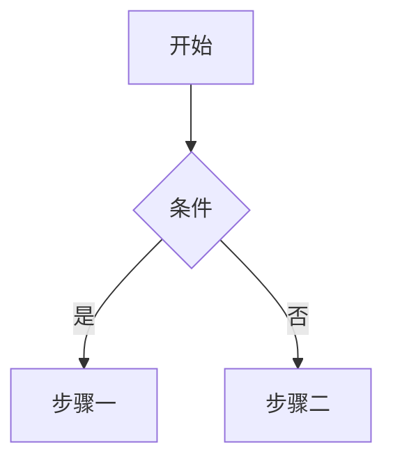
````

### 时序图

````markdown
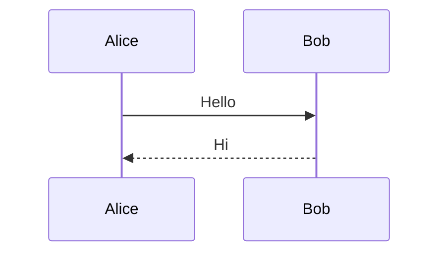
````

### 类图

````markdown
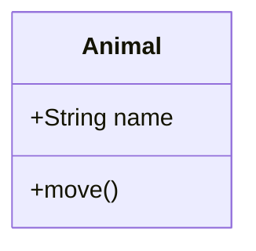
````

### 状态图

````markdown
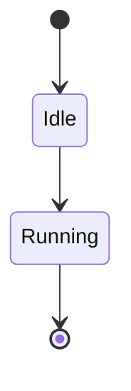
````

### ER 图

````markdown
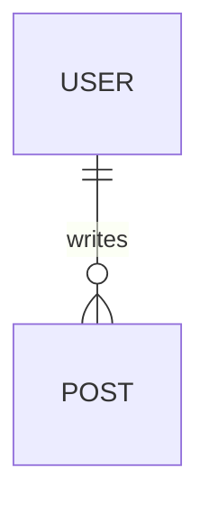
````

### 饼图

````markdown
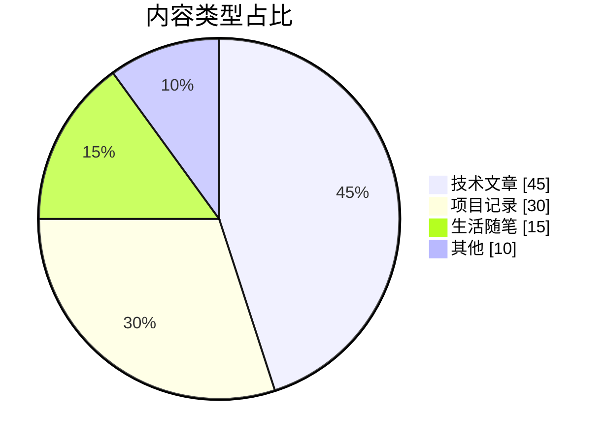
````

### 甘特图

````markdown
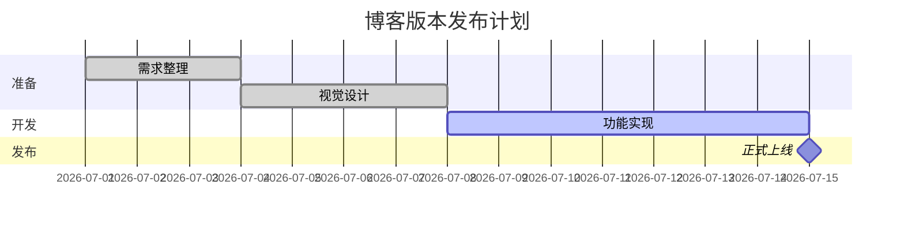
````

### 思维导图

````markdown
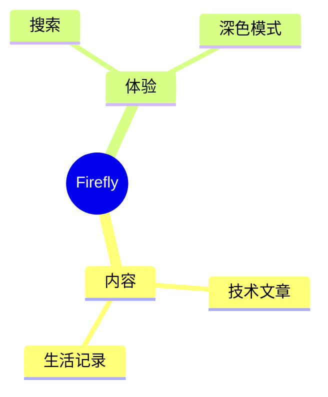
````

### 时间线

````markdown
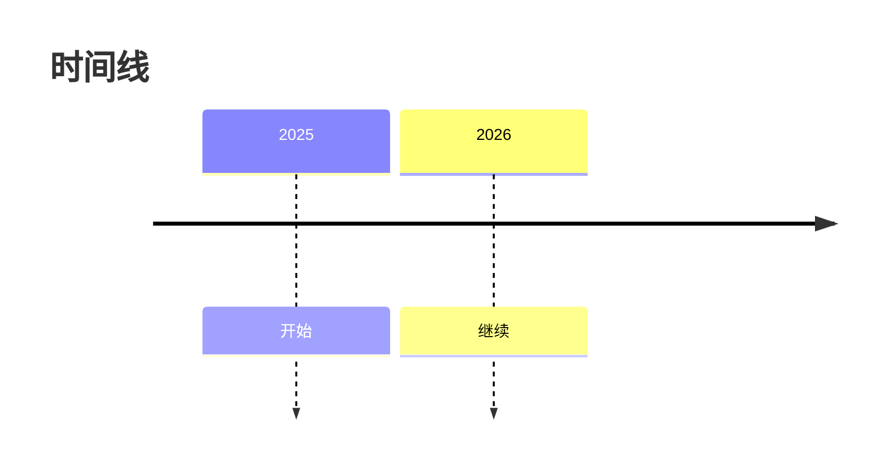
````

### 用户旅程图

````markdown
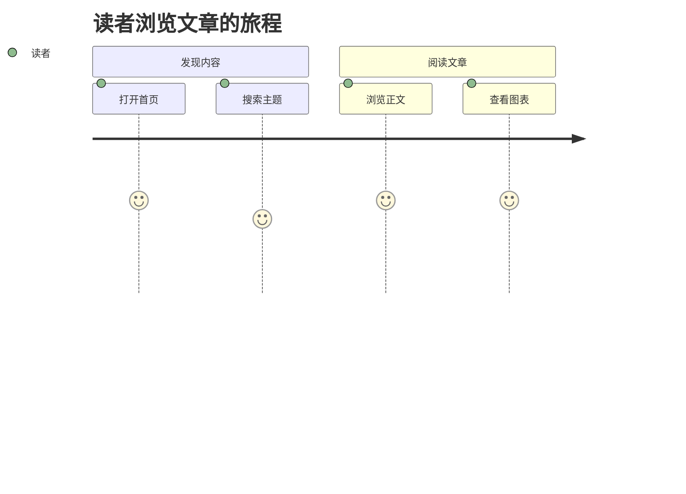
````

### Git 图

````markdown
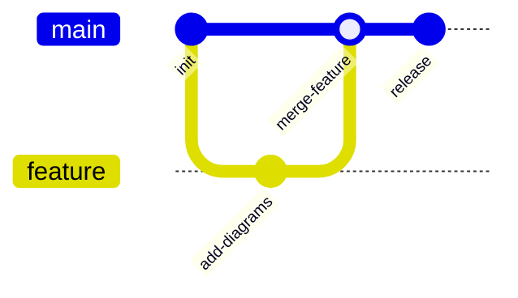
````

### 看板

````markdown
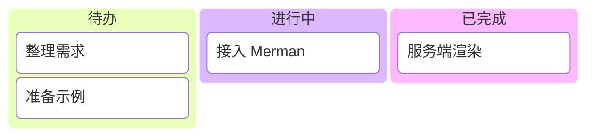
````

### Sankey 图

````markdown
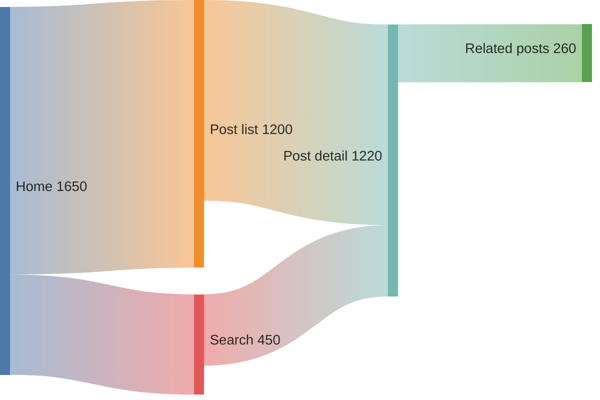
````

### XY 图

````markdown
```mermaid
xychart-beta
  title "月度访问量趋势"
  x-axis [1月, 2月, 3月, 4月, 5月, 6月]
  y-axis "访问量" 0 --> 5000
  bar [2500, 3200, 4100, 3800, 4500, 4800]
  line [2500, 3200, 4100, 3800, 4500, 4800]
```
````

## PlantUML 图表

PlantUML 用纯文本描述工程图，适合和正文一起版本管理。Firefly 在构建阶段编码并生成服务器 SVG 地址，页面端根据亮暗主题自动切换图源，并支持缩放、拖拽和全屏。

````markdown
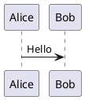
````

常用图表示例：

### 活动图

````markdown
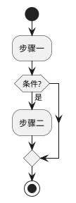
````

### 状态图

````markdown
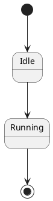
````

### 用例图

````markdown
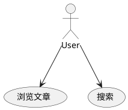
````

### 组件图

````markdown
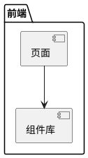
````

### 部署图

````markdown
```plantuml
@startuml
node "浏览器" as Browser
node "服务器" as Server
Browser --> Server
@enduml
```
````

### ER 图

````markdown
```plantuml
@startuml
entity "User" as user
entity "Post" as post
user ||--o{ post
@enduml
```
````

### 时序图（登录与刷新令牌）

````markdown
```plantuml
@startuml
actor User
User -> Client: 登录
Client -> Server: 提交凭证
Server --> Client: access + refresh token
Client -> Server: 用 refresh token 续期
Server --> Client: 新 access token
@enduml
```
````

### C4 风格容器图

````markdown
```plantuml
@startuml
!include <C4/C4_Container>
Person(user, "用户")
System_Boundary(b, "博客") {
  Container(web, "Web", "Astro", "页面")
}
Rel(user, web, "访问")
@enduml
```
````

## MDX 专属组件

以下组件只能在 **`.mdx` 文章**中使用，需要先导入：

```mdx
import { Badge, StepItem, Steps, TabGroup, Timeline, TimelineItem } from '@components/firefly-mdx';
```

### TabGroup

用于把多个代码块合并成可切换的标签页：

| 属性 | 说明 |
| :--- | :--- |
| `labels` | 标签文字数组，按顺序对应组内内容 |
| `client:load` | 加在组件上，保证切换交互可用 |

````mdx
<TabGroup labels={["test.js", "test.py"]} client:load>
  ```js
  console.log(1);
  ```

  ```py
  print("hello")
  ```
</TabGroup>
````

### Timeline / TimelineItem

| 属性 | 必填 | 说明 |
| :--- | :--- | :--- |
| `date` | 否 | 时间标签，如 `"2026-08-16"` |
| `title` | 否 | 条目标题 |
| `type` | 否 | `default` / `tip` / `note` / `important` / `warning` / `caution` |
| `icon` | 否 | `star` / `rocket` / `git` / `flag` / `book` / `heart` / `zap` / `bug` / `tag` / `calendar` / `code` / `edit` |
| 正文 | 否 | 标签内的内容，支持 Markdown |

````mdx
<Timeline>
  <TimelineItem date="2026-08-16" title="新版本发布" icon="rocket">
    发布了新版本。

    - 新增能力
    - 修复问题

    正文支持 **Markdown**。
  </TimelineItem>
  <TimelineItem date="2025-11-02" title="站点上线" type="tip" icon="flag">
    欢迎来到我的博客。
  </TimelineItem>
</Timeline>
````

### Steps / StepItem

编号步骤条，编号自动生成：

| 属性 | 必填 | 说明 |
| :--- | :--- | :--- |
| `title` | 否 | 步骤标题 |
| `type` | 否 | 编号圆颜色，同 Timeline 的 `type` |
| `icon` | 否 | 有图标时显示图标而不是数字 |
| 正文 | 否 | 支持 Markdown |

````mdx
<Steps>
  <StepItem title="安装依赖">运行 `pnpm install`。</StepItem>
  <StepItem title="启动开发服务器" type="tip" icon="rocket">运行 `pnpm dev`。</StepItem>
  <StepItem title="编写文章">在 `src/content/posts/` 新建 `.mdx` 文章。</StepItem>
</Steps>
````

### Badge

内联彩色小徽章：

| 属性 | 说明 |
| :--- | :--- |
| `type` | `default` / `tip` / `note` / `important` / `warning` / `caution` |

````mdx
<Badge>新功能</Badge>
<Badge type="tip">提示</Badge>
<Badge type="warning">注意</Badge>
````

## 草稿 / 隐藏文章

frontmatter 的 `draft` 有三种取值：

| 值 | 效果 |
| :--- | :--- |
| `false` | 正常展示 |
| `true` | 只在 `pnpm dev` 中出现，生产构建和搜索索引排除 |
| `"dead"` | 任何模式都不展示，也不生成页面；适合放示例稿、参考文档 |

```yaml
draft: true      # 仅开发模式可见
draft: "dead"    # 永久隐藏
```

## 文章加密

frontmatter 设置密码后，文章内容会被加密，访问时要求输入密码：

```yaml
password: "123456"
passwordHint: "提示文字"
```

密码错误时显示 `passwordHint`，正确后前端解密展示正文。

## 系列文章

用 `series` 和 `seriesOrder` 把文章串成系列，文章页会显示系列导航：

```yaml
series: "Firefly 功能示例"
seriesOrder: 1
```

## 其他常用 frontmatter

```yaml
title: 文章标题
published: 2026-11-23
updated: 2026-11-23
description: 文章描述
image: ""
tags: [Markdown, Firefly]
category: 教程
slug: custom-slug         # 不写则用文件名
pinned: false             # 置顶
comment: true             # 是否允许评论
```

## 小结

| 功能 | 语法 |
| :--- | :--- |
| 提醒框 | `> [!NOTE]` |
| 剧透 | `:spoiler[内容]` |
| GitHub 卡片 | `::github{repo="owner/repo"}` |
| Wiki 链接 | `[[slug]]`、`[[slug\|标题]]`、`[[slug#标题]]` |
| 图片网格 | `[grid] ... [/grid]` |
| Tab 代码组 | `::: code-group labels=[...]` |
| 数学公式 | `$...$`、`$$...$$` |
| 图表 | ` ```mermaid `、` ```plantuml ` |
| MDX 组件 | `.mdx` + `@components/firefly-mdx` |
| 草稿 | `draft: true` |
| 加密 | `password` / `passwordHint` |
